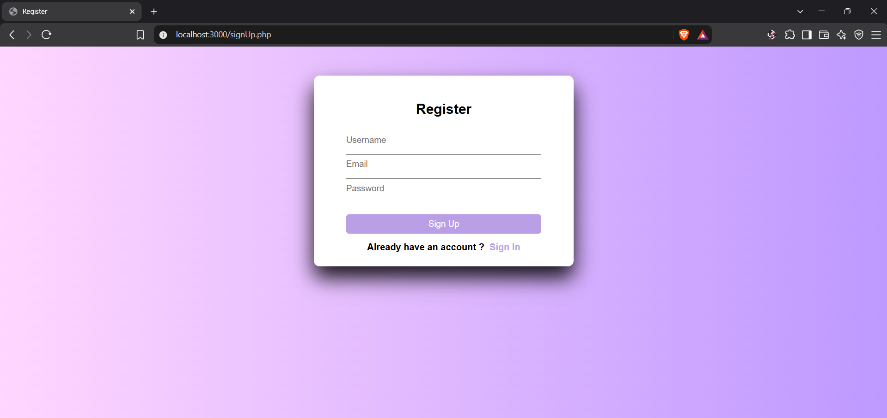
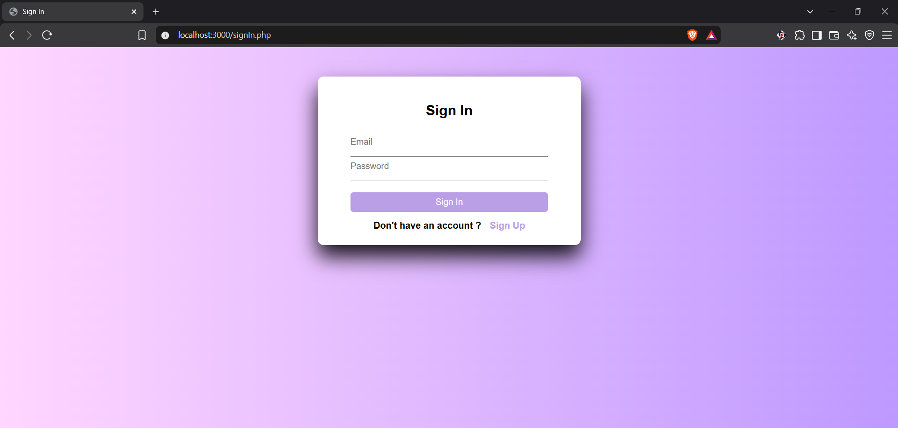
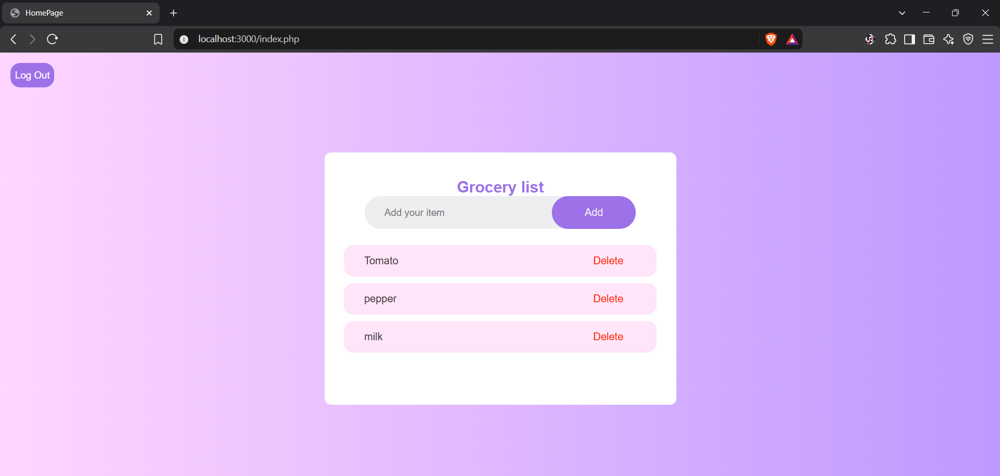

# grocery-list-app
A simple grocery list app with user accounts. Each user has their own private list -sign up, log in, add items, delete items.

Built as a side project to practice full-stack CRUD with authentication.

## Tech Stack
- PHP (vanilla, no framework)
- MySQL
- HTML & CSS
## Features
- User registration with hashed passwords
- Login/Logout with sessions
- Add and delete grocery items
- Users can only see and modify their own items
 ## How to Run Locally
 1. Install [XAMPP](https://www.apachefriends.org/download.html)
 2. Start Apache and MySQL
 3. Import database.sql via phpMyAdmin (http://localhost/phpmyadmin)
 4. Copy the project folder into htdocs/
 5. Open http://localhost/grocery-list
## Screenshots
- Sign Up Form

- Sign In Form

- HomePage

## What I'd Add Next
- Edit item names in place(currently: delete + re-add)
- Mark items as bought
- Per-user item ordering
## Notes 
- Passwords are hashed with password_hash()
- Every item query is scoped by user_id so users can't access each other's data
